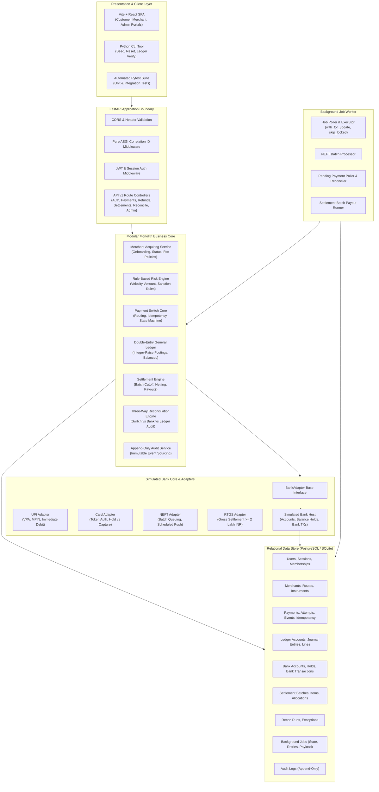
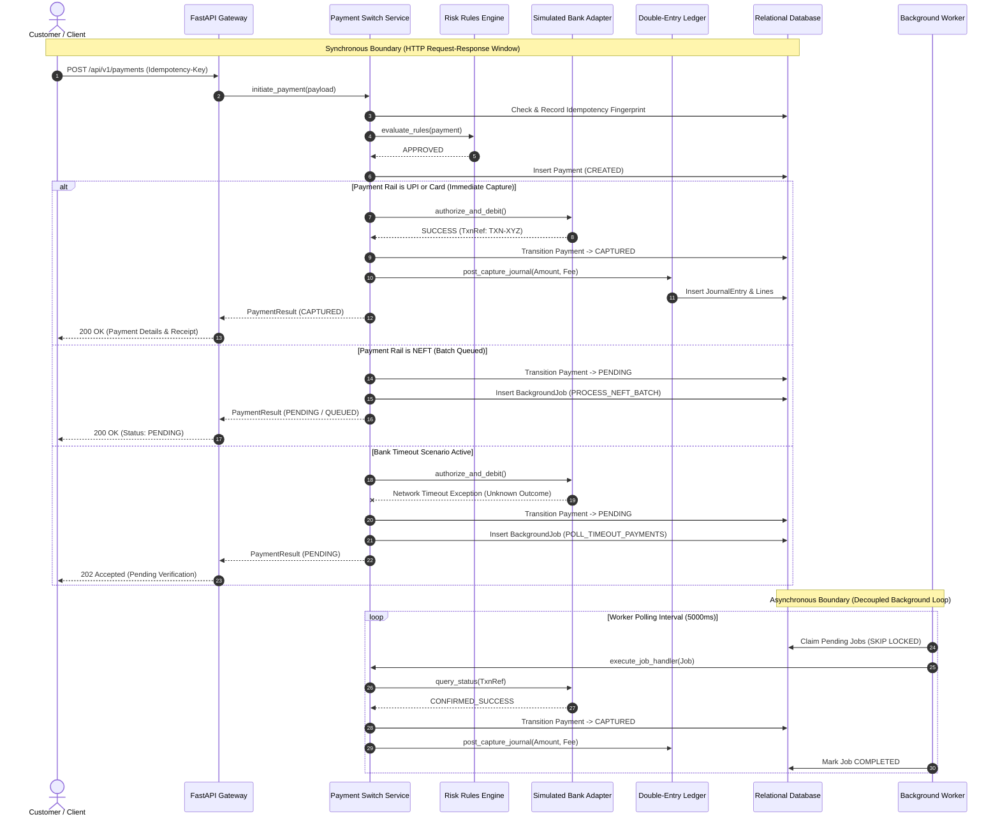

# Secure Payment Switch & Merchant Acquiring Simulator
## System Architecture Specification

---

## 1. Architectural Overview

The **Secure Payment Switch & Merchant Acquiring Simulator** is designed as a modular monolith. This architectural pattern was chosen to deliver high cohesion, operational simplicity for academic evaluation, and zero-loss transactional consistency without the latency, network unreliability, and distributed transaction overhead (e.g., Two-Phase Commit / Sagas) inherent to distributed microservices.

The architecture cleanly decouples route handlers, domain business services, bank adapters, background workers, and data persistence models through clear layer boundaries and transactional units of work.



---

## 2. Core Component Responsibilities

### 2.1 API Layer & Middleware
- **Correlation Tracking:** The pure ASGI `CorrelationIdMiddleware` assigns or propagates an `X-Correlation-ID` (UUID4) across every HTTP request and attaches it to Python logging records and the response headers.
- **Authentication & Authorization:** Handles bcrypt password verification and cryptographically signed JWT bearer tokens. Enforces role-based access control (`CUSTOMER`, `MERCHANT`, `ADMIN`) and merchant membership ownership on all private endpoints.
- **Error Normalization:** Global exception handlers trap `DomainException`, `PaymentException`, `IdempotencyConflictException`, and validation errors, mapping them to structured RFC 7807 JSON error responses without leaking internal stack traces.

### 2.2 Payment Switch Core (`PaymentService`)
- **Idempotency Gatekeeper:** Inspects incoming `Idempotency-Key` headers. Computes a SHA-256 fingerprint of the request method, path, and normalized body. If an in-flight key is seen, blocks concurrency; if an executed key is seen, returns the exact cached response.
- **Strict State Machine:** Validates and executes state transitions across `CREATED`, `PENDING`, `AUTHORIZED`, `CAPTURED`, `FAILED`, and `REVERSED`. Rejects invalid or out-of-order transitions (e.g., `CAPTURED -> FAILED`).
- **Dynamic Routing:** Selects an active `PaymentRoute` matching the currency (INR), payment method, and amount thresholds.
- **Scenario Interceptor:** Consults the active `SimulationScenario` table before invoking bank adapters to inject deterministic failures (delays, timeouts, insufficient funds, incorrect credentials, bank downtime).

### 2.3 Simulated Bank Adapters
All payment rails implement a uniform `BankAdapter` abstract base interface:
- **`UPIAdapter`:** Simulates Virtual Payment Address (`user@bank`) format verification, MPIN validation (against demo secrets), and immediate account-to-account debit/credit.
- **`CardAdapter`:** Implements two-phase payments. Card authorization places an atomic `BalanceHold` on the issuing bank account without crediting the merchant. Capture releases the hold, debits the customer account, and credits the acquiring settlement clearing account.
- **`NEFTAdapter`:** Simulates Indian National Electronic Funds Transfer. Payments are accepted and held in `PENDING` / `QUEUED` status, waiting for the hourly batch execution job to debit and clear funds.
- **`RTGSAdapter`:** Simulates Real-Time Gross Settlement. Enforces Indian retail banking business rules (minimum eligible threshold of ₹2,00,000 / 20,000,000 paise). Processes gross one-to-one transfers immediately with high priority.

### 2.4 Double-Entry General Ledger (`LedgerService`)
Maintains an immutable financial record.
- **Integer Arithmetic:** All monetary amounts are stored in integer paise (1 INR = 100 paise) to prevent IEEE 754 floating-point precision errors.
- **Invariance Rule:** For every `JournalEntry`, the sum of debit lines must mathematically equal the sum of credit lines:
  $$\sum \text{Debit Amounts} = \sum \text{Credit Amounts}$$
- **Account Chart:**
  - `ASSETS:SIMULATED_RESERVE_CASH`
  - `ASSETS:ACQUIRER_CLEARING`
  - `LIABILITIES:CUSTOMER_DEPOSITS`
  - `LIABILITIES:MERCHANT_PAYABLE`
  - `REVENUE:SWITCH_INTERCHANGE_FEES`
  - `EXPENSE:BANK_PROCESSING_FEES`

### 2.5 Merchant Acquiring & Settlement Engine (`SettlementService`)
- **Snapshot Fee Calculation:** At payment capture, applies the merchant's configured basis points (bps) and fixed fee paise:
  $$\text{Fee} = \left\lfloor \frac{\text{Amount} \times \text{fee\_rate\_bps}}{10000} \right\rfloor + \text{fee\_fixed\_paise}$$
  The fee is recorded permanently on the `Payment` record so subsequent fee policy changes never corrupt historical transactions.
- **Net Settlement:** Aggregates eligible captured payments within a cutoff window, subtracts fees and refunds, creates a `SettlementBatch`, and initiates automated payouts to the merchant's fictional nodal bank account.

### 2.6 Three-Way Reconciliation Engine (`ReconciliationService`)
An independent audit subsystem that verifies financial consistency across three disjoint planes:
1. **Switch Payment Records:** Internal transaction statuses and captured amounts.
2. **Simulated Bank Host Records:** External bank statement logs recorded by issuing/clearing banks.
3. **General Ledger Journal:** Immutable double-entry accounting postings.

Detects and categorizes mismatches:
- `MISSING_IN_BANK`: Payment is `CAPTURED` on the switch but missing in the bank core.
- `STATUS_MISMATCH`: Payment is `CAPTURED` on the switch but `FAILED` at the bank.
- `AMOUNT_MISMATCH`: The switch captured amount differs from the bank debited amount.
- `UNBALANCED_LEDGER`: Journal entry debits do not match credits.

### 2.7 Background Job Worker (`WorkerEngine`)
A dedicated background daemon operating on the `background_jobs` table:
- Implements concurrency-safe job claiming using PostgreSQL `SELECT ... FOR UPDATE SKIP LOCKED` (with database-agnostic fallback for SQLite).
- Handles job retries with exponential backoff and maximum retry caps.
- Executes:
  - `PROCESS_NEFT_BATCH`: Sweeps queued NEFT transfers and clears them.
  - `POLL_TIMEOUT_PAYMENTS`: Resolves payments stuck in `PENDING` due to bank timeout scenarios.
  - `EXECUTE_SETTLEMENT_PAYOUT`: Retries failed merchant settlement disbursements.

---

## 3. Synchronous vs. Asynchronous Execution Boundaries



---

## 4. Deployment Architecture

The application is containerized using multi-stage Docker builds and orchestrated with Docker Compose.

```mermaid
flowchart TD
    subgraph HostEnv["Host Environment"]
        subgraph DockerCompose["Docker Compose Virtual Network (payment-network)"]
            subgraph FrontendContainer["Frontend Container (Port 80:80)"]
                NGINX["Nginx Web Server"]
                STATIC["Built React 18 / Vite Static Bundle"]
                NGINX --> STATIC
            end

            subgraph BackendContainer["Backend Container (Port 8000:8000)"]
                UVICORN["Uvicorn ASGI Server"]
                FASTAPI["FastAPI Modular Application"]
                UVICORN --> FASTAPI
            end

            subgraph WorkerContainer["Worker Container"]
                WORKER_PROC["Python Async Job Worker Daemon<br/>(python -m app.cli run-worker)"]
            end

            subgraph DBContainer["Database Container (Port 5432:5432)"]
                PG["PostgreSQL 15 Alpine"]
                VOLUME[("Named Volume: pgdata")]
                PG --> VOLUME
            end
        end

        BROWSER["Web Browser / Evaluator<br/>http://localhost"]
        ADMIN_CLI["Admin Terminal<br/>docker compose exec backend"]
    end

    BROWSER -->|Port 80 (HTTP)| NGINX
    NGINX -->|Reverse Proxy /api/*| UVICORN
    FASTAPI -->|TCP 5432 / SQLAlchemy| PG
    WORKER_PROC -->|TCP 5432 / SQLAlchemy| PG
    ADMIN_CLI --> FASTAPI
```

### Container Specifications:
1. **`db` (PostgreSQL 15):** Relational store configured with persistent named volume, transactional isolation (`READ COMMITTED`), and health checks (`pg_isready`).
2. **`backend` (FastAPI / Uvicorn):** Python 3.9+ container exposing the REST API, OpenAPI docs at `/docs`, and background job dispatch.
3. **`worker` (Python Daemon):** Reuses the backend image to run `python -m app.cli run-worker`, ensuring identical business logic and model definitions.
4. **`frontend` (Nginx + React):** Multi-stage build producing optimized static JS/CSS, served via Nginx with reverse proxy rules routing `/api/` traffic directly to the backend container.

---

## 5. Architectural Invariants & Failure Resilience

1. **Conservation of Money:** In the double-entry ledger, money is never created or destroyed out of thin air. Balance increases in merchant receivables are strictly offset by balance increases in acquirer clearing and decreases in customer deposits.
2. **Strict Idempotency:** Any duplicate request with identical `Idempotency-Key` and matching body hash receives the cached original response without re-executing bank debits or ledger postings.
3. **Timeout Non-Finality:** A timeout is treated as an ambiguous state (`PENDING`), never an outright `FAILED`. The background worker or reconciliation engine resolves the final state against the bank core.
4. **Append-Only Auditing:** Audit logs and transaction events cannot be updated or deleted through the application interface.
5. **Zero Floating Point Math:** All monetary representations use 64-bit integer paise to prevent fractional discrepancies.
