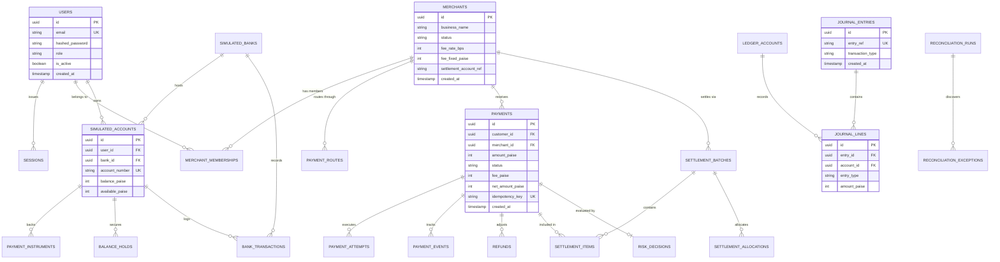

# Secure Payment Switch & Merchant Acquiring Simulator
## Relational Database Schema & Data Dictionary

---

## 1. Entity-Relationship Overview

The platform uses a relational schema designed for strict relational integrity, foreign key cascading safety, and auditability. The models are implemented using SQLAlchemy 2.0 and version-controlled via Alembic migrations.

---

## 2. Integer-Paise Monetary Representation

In financial engineering, floating-point representations (such as IEEE 754 `float` or `double`) are strictly prohibited due to non-terminating binary expansions (e.g., $0.1 + 0.2 \neq 0.3$). 

To ensure mathematical precision and legal correctness:
1. **Base Currency:** Indian Rupee (INR).
2. **Sub-Unit:** 1 INR = 100 Paise.
3. **Storage Type:** 64-bit Integer (`BIGINT` in PostgreSQL, `Integer` in SQLite).
4. **Calculations:**
   - ₹1,500.50 is stored as `150050`.
   - Basis point calculation uses integer floor division:
     $$\text{Fee} = \left\lfloor \frac{\text{Amount} \times \text{bps}}{10000} \right\rfloor + \text{Fixed Paise}$$
   - Rounding direction is strictly documented and deterministic.

---

## 3. Data Dictionary

### 3.1 Identity & Access Control

#### `users`
Represents customer, merchant, and administrator user accounts.
| Column | Type | Constraints | Description |
|---|---|---|---|
| `id` | UUID | PK, Not Null | Unique user identifier |
| `email` | VARCHAR(255) | UK, Not Null, Index | User login email |
| `hashed_password` | VARCHAR(255) | Not Null | Bcrypt password hash |
| `full_name` | VARCHAR(255) | Not Null | Full legal or display name |
| `role` | VARCHAR(50) | Not Null | `CUSTOMER`, `MERCHANT`, or `ADMIN` |
| `is_active` | BOOLEAN | Not Null, Default TRUE | Account activation flag |
| `created_at` | TIMESTAMP | Not Null | UTC account creation timestamp |
| `updated_at` | TIMESTAMP | Not Null | UTC last update timestamp |

#### `session_tokens`
Tracks active sessions and bearer tokens.
| Column | Type | Constraints | Description |
|---|---|---|---|
| `id` | UUID | PK, Not Null | Token identifier |
| `user_id` | UUID | FK(`users.id`), Not Null | Associated user |
| `token_hash` | VARCHAR(255) | UK, Not Null | SHA-256 hash of the issued JWT |
| `expires_at` | TIMESTAMP | Not Null | Expiration timestamp |
| `is_revoked` | BOOLEAN | Not Null, Default FALSE | Revocation flag |

#### `merchants`
Stores acquired business merchant profiles and fee configurations.
| Column | Type | Constraints | Description |
|---|---|---|---|
| `id` | UUID | PK, Not Null | Unique merchant identifier |
| `business_name` | VARCHAR(255) | Not Null | Legal business name |
| `contact_email` | VARCHAR(255) | Not Null | Business operational contact |
| `category` | VARCHAR(100) | Not Null | Business classification (e.g., E-COMMERCE, RETAIL) |
| `status` | VARCHAR(50) | Not Null | `PENDING`, `APPROVED`, `REJECTED`, `SUSPENDED` |
| `fee_rate_bps` | INTEGER | Not Null, Default 150 | Variable fee rate in basis points (1.50% = 150 bps) |
| `fee_fixed_paise` | INTEGER | Not Null, Default 500 | Fixed transaction fee in paise (₹5.00 = 500 paise) |
| `settlement_account_ref` | VARCHAR(100) | Not Null | Fictional merchant settlement account identifier |
| `created_at` | TIMESTAMP | Not Null | Onboarding initiation timestamp |
| `approved_at` | TIMESTAMP | Nullable | Admin approval timestamp |

#### `merchant_memberships`
Explicit role-based association between users and merchants.
| Column | Type | Constraints | Description |
|---|---|---|---|
| `id` | UUID | PK, Not Null | Membership identifier |
| `user_id` | UUID | FK(`users.id`), Not Null | User identifier |
| `merchant_id` | UUID | FK(`merchants.id`), Not Null | Merchant identifier |
| `role` | VARCHAR(50) | Not Null | Membership role (`OWNER`, `MANAGER`, `ANALYST`) |
| `created_at` | TIMESTAMP | Not Null | Creation timestamp |

---

### 3.2 Simulated Banking & Payment Instruments

#### `simulated_banks`
Simulates partner issuing, acquiring, and clearing banks.
| Column | Type | Constraints | Description |
|---|---|---|---|
| `id` | UUID | PK, Not Null | Bank identifier |
| `code` | VARCHAR(20) | UK, Not Null | Bank IFSC prefix code (e.g., `SBIN`, `HDFC`, `ICIC`) |
| `name` | VARCHAR(255) | Not Null | Full bank name |
| `status` | VARCHAR(50) | Not Null | `OPERATIONAL`, `DEGRADED`, `DOWN` |
| `latency_ms` | INTEGER | Not Null, Default 0 | Simulated network latency injection |
| `created_at` | TIMESTAMP | Not Null | Creation timestamp |

#### `simulated_accounts`
Simulates customer and merchant ledger accounts hosted at simulated banks.
| Column | Type | Constraints | Description |
|---|---|---|---|
| `id` | UUID | PK, Not Null | Account identifier |
| `user_id` | UUID | FK(`users.id`), Nullable | Account owner |
| `bank_id` | UUID | FK(`simulated_banks.id`), Not Null | Host bank |
| `account_number` | VARCHAR(50) | UK, Not Null | Fictional bank account number |
| `account_type` | VARCHAR(50) | Not Null | `SAVINGS`, `CURRENT`, `NOSTRO`, `VOSTRO` |
| `balance_paise` | BIGINT | Not Null, CHECK(`balance_paise >= 0`) | Book ledger balance |
| `available_paise` | BIGINT | Not Null, CHECK(`available_paise >= 0`) | Available balance (`balance - holds`) |
| `currency` | VARCHAR(3) | Not Null, Default 'INR' | Currency code |

#### `payment_instruments`
Tokenized payment methods associated with customer accounts.
| Column | Type | Constraints | Description |
|---|---|---|---|
| `id` | UUID | PK, Not Null | Instrument identifier |
| `customer_id` | UUID | FK(`users.id`), Not Null | Instrument owner |
| `account_id` | UUID | FK(`simulated_accounts.id`), Not Null | Underlying bank account |
| `method_type` | VARCHAR(50) | Not Null | `UPI`, `CARD`, `NEFT`, `RTGS` |
| `masked_identifier` | VARCHAR(100) | Not Null | Masked label (e.g. `**** 4242`, `user@okhdfc`) |
| `token` | VARCHAR(255) | UK, Not Null | Tokenized instrument handle |
| `demo_secret` | VARCHAR(255) | Nullable | Encrypted/hashed demo authentication credential |
| `is_active` | BOOLEAN | Not Null, Default TRUE | Status flag |

#### `balance_holds`
Temporary holds on funds during two-phase card authorizations.
| Column | Type | Constraints | Description |
|---|---|---|---|
| `id` | UUID | PK, Not Null | Hold identifier |
| `account_id` | UUID | FK(`simulated_accounts.id`), Not Null | Held account |
| `payment_id` | UUID | FK(`payments.id`), Not Null | Associated payment |
| `amount_paise` | BIGINT | Not Null | Held amount in paise |
| `status` | VARCHAR(50) | Not Null | `ACTIVE`, `CAPTURED`, `RELEASED`, `EXPIRED` |
| `created_at` | TIMESTAMP | Not Null | Hold creation timestamp |

---

### 3.3 Payment Switch Core & Transactions

#### `payments`
Core transaction table tracking payment lifecycles.
| Column | Type | Constraints | Description |
|---|---|---|---|
| `id` | UUID | PK, Not Null | Payment identifier |
| `customer_id` | UUID | FK(`users.id`), Not Null | Payer user |
| `merchant_id` | UUID | FK(`merchants.id`), Not Null | Payee merchant |
| `instrument_id` | UUID | FK(`payment_instruments.id`), Not Null | Payment instrument |
| `payment_method` | VARCHAR(50) | Not Null | `UPI`, `CARD`, `NEFT`, `RTGS` |
| `amount_paise` | BIGINT | Not Null, CHECK(`amount_paise > 0`) | Total payment amount |
| `currency` | VARCHAR(3) | Not Null, Default 'INR' | Currency |
| `status` | VARCHAR(50) | Not Null | Current payment state |
| `merchant_order_ref`| VARCHAR(100) | Nullable | Merchant-provided order reference |
| `idempotency_key` | VARCHAR(255) | UK, Not Null | Client idempotency key |
| `fee_rate_bps_snapshot`| INTEGER | Not Null | Snapshot basis points at initiation |
| `fee_fixed_paise_snapshot`| INTEGER | Not Null | Snapshot fixed paise fee |
| `fee_paise` | BIGINT | Not Null | Calculated acquiring fee |
| `net_amount_paise` | BIGINT | Not Null | Merchant payable (`amount - fee`) |
| `failure_code` | VARCHAR(100) | Nullable | Error category on failure |
| `failure_reason` | TEXT | Nullable | Detailed failure description |
| `settlement_status`| VARCHAR(50) | Not Null, Default 'UNSETTLED'| `UNSETTLED`, `SETTLED`, `EXCLUDED` |
| `created_at` | TIMESTAMP | Not Null, Index | Creation timestamp |
| `updated_at` | TIMESTAMP | Not Null | Last state transition timestamp |

#### `idempotency_records`
Ensures duplicate HTTP requests produce exact, safe cached responses.
| Column | Type | Constraints | Description |
|---|---|---|---|
| `id` | UUID | PK, Not Null | Record identifier |
| `idempotency_key` | VARCHAR(255) | UK, Not Null, Index | Client idempotency token |
| `user_id` | UUID | FK(`users.id`), Not Null | Requesting user |
| `request_path` | VARCHAR(255) | Not Null | HTTP request endpoint |
| `request_payload_hash`| VARCHAR(64) | Not Null | SHA-256 hash of canonical request JSON |
| `status` | VARCHAR(50) | Not Null | `PROCESSING`, `COMPLETED`, `FAILED` |
| `response_code` | INTEGER | Nullable | HTTP status code |
| `response_body` | TEXT | Nullable | JSON response body cache |
| `created_at` | TIMESTAMP | Not Null | Request timestamp |

#### `payment_events`
Append-only timeline of payment transitions and adapter exchanges.
| Column | Type | Constraints | Description |
|---|---|---|---|
| `id` | UUID | PK, Not Null | Event identifier |
| `payment_id` | UUID | FK(`payments.id`), Not Null, Index | Associated payment |
| `from_status` | VARCHAR(50) | Nullable | Previous state |
| `to_status` | VARCHAR(50) | Not Null | Resulting state |
| `event_type` | VARCHAR(100) | Not Null | Event descriptor (e.g. `BANK_AUTH_SUCCESS`) |
| `details` | JSON / TEXT | Nullable | Serialized event payload |
| `created_at` | TIMESTAMP | Not Null | Timestamp |

---

### 3.4 General Ledger & Accounting

#### `ledger_accounts`
Chart of accounts for the internal double-entry ledger.
| Column | Type | Constraints | Description |
|---|---|---|---|
| `id` | UUID | PK, Not Null | Account identifier |
| `account_code` | VARCHAR(100) | UK, Not Null | Unique account code (e.g. `LIABILITIES:MERCHANT_PAYABLE`) |
| `account_name` | VARCHAR(255) | Not Null | Human-readable account name |
| `account_type` | VARCHAR(50) | Not Null | `ASSET`, `LIABILITY`, `EQUITY`, `REVENUE`, `EXPENSE` |
| `balance_paise` | BIGINT | Not Null, Default 0 | Calculated net balance |

#### `journal_entries`
Header for double-entry transactions.
| Column | Type | Constraints | Description |
|---|---|---|---|
| `id` | UUID | PK, Not Null | Journal entry identifier |
| `entry_ref` | VARCHAR(100) | UK, Not Null | Unique reference (e.g. `JE-TXN-123`) |
| `transaction_type` | VARCHAR(100) | Not Null | `PAYMENT_CAPTURE`, `REFUND`, `SETTLEMENT_PAYOUT` |
| `description` | TEXT | Not Null | Accounting memo |
| `created_at` | TIMESTAMP | Not Null | Journal posting timestamp |

#### `journal_lines`
Individual debit and credit postings.
| Column | Type | Constraints | Description |
|---|---|---|---|
| `id` | UUID | PK, Not Null | Line identifier |
| `entry_id` | UUID | FK(`journal_entries.id`), Not Null | Associated journal entry |
| `account_id` | UUID | FK(`ledger_accounts.id`), Not Null | Target ledger account |
| `entry_type` | VARCHAR(10) | Not Null | `DEBIT` or `CREDIT` |
| `amount_paise` | BIGINT | Not Null, CHECK(`amount_paise > 0`) | Posting amount in paise |

---

### 3.5 Settlement & Reconciliation

#### `settlement_batches`
Records periodic merchant payout batches.
| Column | Type | Constraints | Description |
|---|---|---|---|
| `id` | UUID | PK, Not Null | Batch identifier |
| `batch_ref` | VARCHAR(100) | UK, Not Null | Unique reference (e.g. `SETTLE-20261029-01`) |
| `merchant_id` | UUID | FK(`merchants.id`), Not Null | Settled merchant |
| `gross_amount_paise`| BIGINT | Not Null | Sum of captured payments |
| `fee_amount_paise` | BIGINT | Not Null | Total fee deductions |
| `refund_amount_paise`| BIGINT | Not Null | Total refund deductions |
| `net_payout_paise` | BIGINT | Not Null | Final disbursement amount |
| `status` | VARCHAR(50) | Not Null | `CALCULATED`, `PROCESSING`, `SETTLED`, `FAILED` |
| `created_at` | TIMESTAMP | Not Null | Batch creation timestamp |
| `settled_at` | TIMESTAMP | Nullable | Payout execution timestamp |

#### `reconciliation_runs`
Audit runs comparing switch, bank, and ledger data.
| Column | Type | Constraints | Description |
|---|---|---|---|
| `id` | UUID | PK, Not Null | Run identifier |
| `run_ref` | VARCHAR(100) | UK, Not Null | Unique run reference |
| `total_records` | INTEGER | Not Null | Total evaluated records |
| `matched_records` | INTEGER | Not Null | Records in full agreement |
| `exceptions_count`| INTEGER | Not Null | Discrepancies flagged |
| `status` | VARCHAR(50) | Not Null | `COMPLETED`, `IN_PROGRESS` |
| `created_at` | TIMESTAMP | Not Null | Audit run timestamp |

#### `reconciliation_exceptions`
Discrepancies identified during three-way reconciliation.
| Column | Type | Constraints | Description |
|---|---|---|---|
| `id` | UUID | PK, Not Null | Exception identifier |
| `run_id` | UUID | FK(`reconciliation_runs.id`), Not Null | Associated run |
| `payment_id` | UUID | FK(`payments.id`), Nullable | Flagged payment |
| `exception_type` | VARCHAR(100) | Not Null | `MISSING_IN_BANK`, `STATUS_MISMATCH`, `AMOUNT_MISMATCH` |
| `switch_data` | JSON / TEXT | Nullable | Snapshot of switch record |
| `bank_data` | JSON / TEXT | Nullable | Snapshot of bank record |
| `ledger_data` | JSON / TEXT | Nullable | Snapshot of ledger record |
| `status` | VARCHAR(50) | Not Null | `OPEN`, `RESOLVED`, `IGNORED` |
| `resolution_note` | TEXT | Nullable | Admin recorded resolution explanation |
| `resolved_at` | TIMESTAMP | Nullable | Resolution timestamp |

---

## 4. Integrity Invariants & Constraints

1. **Foreign Key Integrity:** All child relationships use cascade rules where appropriate (e.g., deleting a journal entry deletes its journal lines).
2. **Double-Entry Balance Constraint:** Application services verify that for every transaction:
   $$\sum \text{DEBIT} - \sum \text{CREDIT} = 0$$
   A rollback is triggered if this invariant is violated.
3. **Idempotency Uniqueness:** `idempotency_key` is unique across all payments, preventing race conditions via database-level unique indexes.
4. **Non-Negative Balances:** Check constraints on `simulated_accounts` guarantee balances cannot drop below zero unless specifically permitted for credit facilities.
