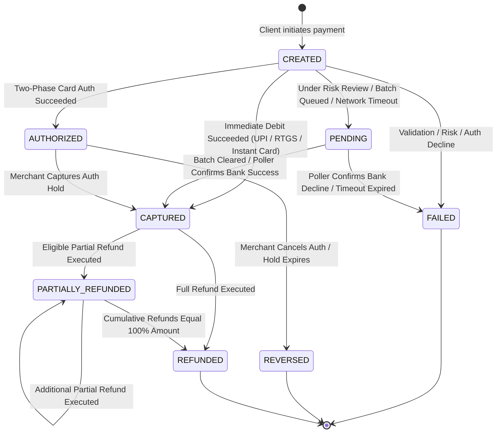
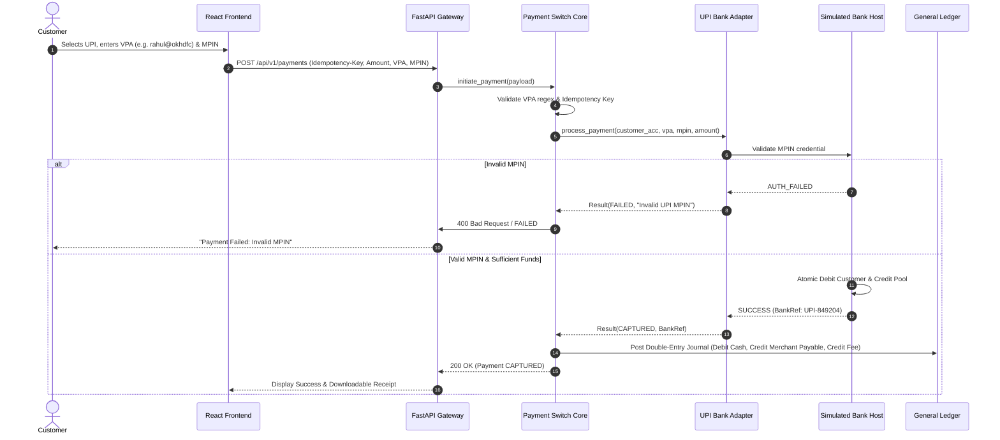
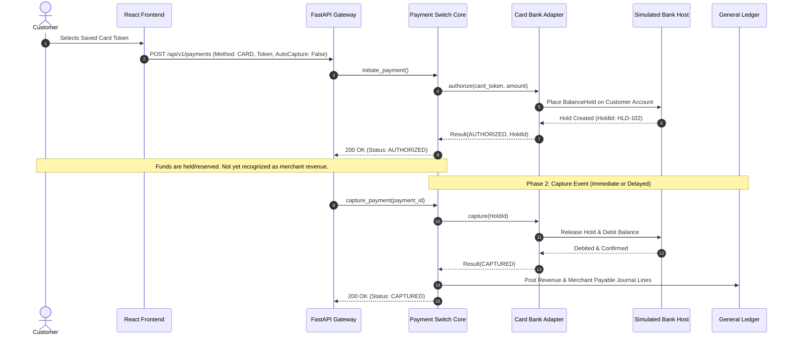
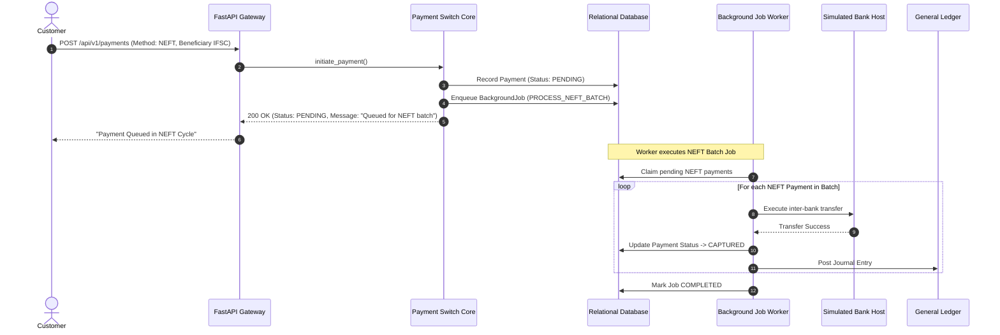
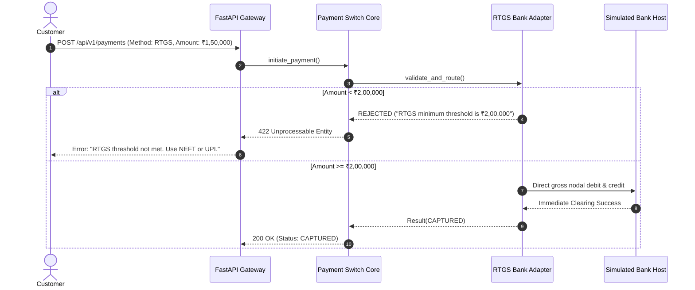
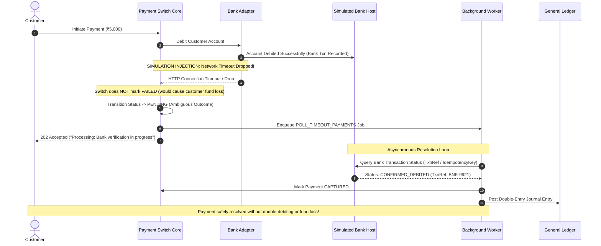
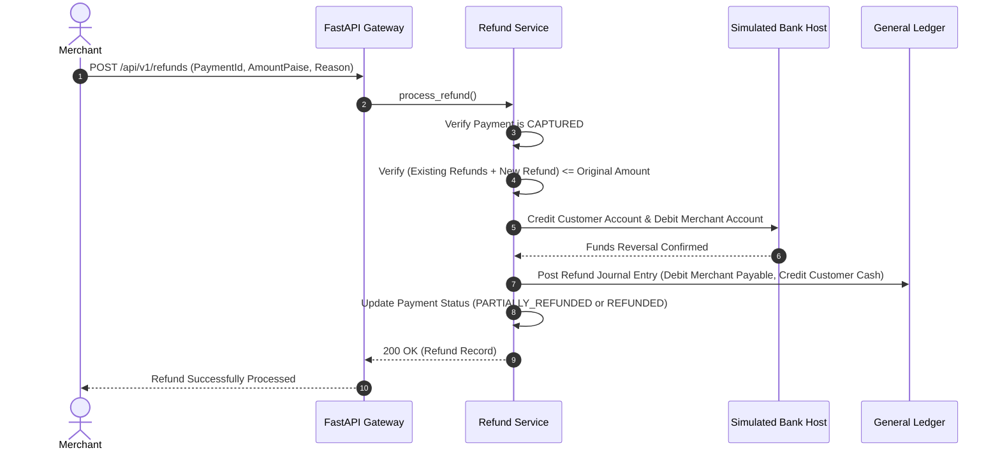
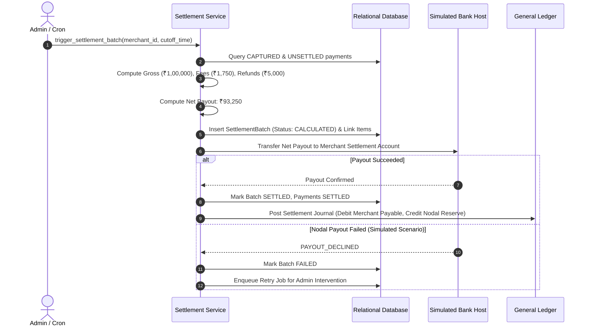
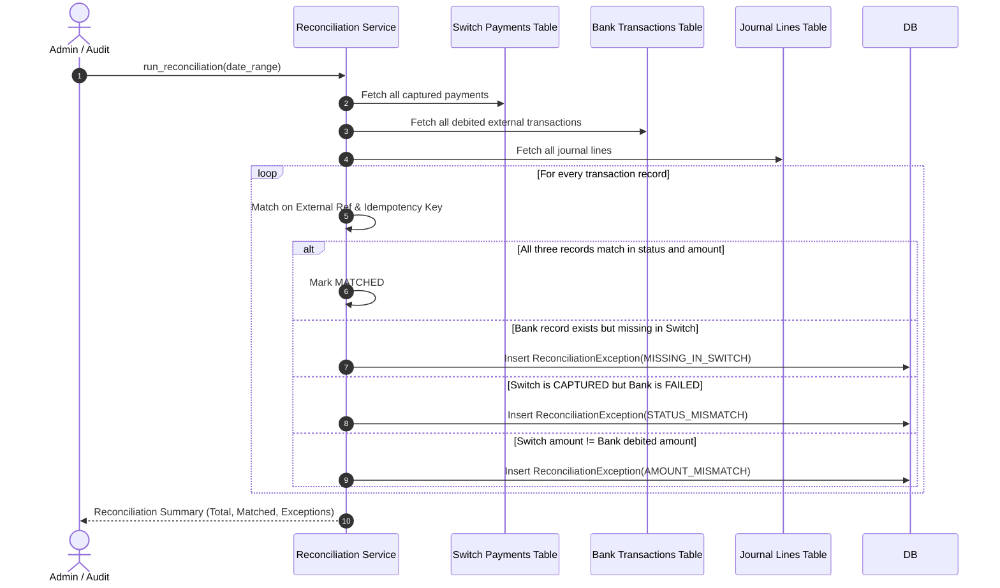

# Secure Payment Switch & Merchant Acquiring Simulator
## Payment Lifecycle, State Machines & Transaction Sequences

---

## 1. Payment State Machine Specification

Transactions within the payment switch adhere to a deterministic finite state machine (FSM). Illegal state transitions (e.g., attempting to transition a `CAPTURED` payment to `FAILED`, or transitioning from `REVERSED` to `AUTHORIZED`) are strictly rejected by the core state machine (`app/core/state_machine.py`) with a domain exception.

### Transition Validity Matrix
| Current State | Target State | Permitted? | Trigger / Context |
|---|---|---|---|
| `CREATED` | `PENDING` | Yes | NEFT batch queue, high risk review, bank network timeout |
| `CREATED` | `AUTHORIZED` | Yes | Card authorization hold successful |
| `CREATED` | `CAPTURED` | Yes | Instant one-phase capture (UPI, RTGS, Instant Card) |
| `CREATED` | `FAILED` | Yes | Insufficient funds, bad MPIN/token, bank downtime |
| `PENDING` | `CAPTURED` | Yes | Async worker NEFT batch cleared, status poller confirmation |
| `PENDING` | `FAILED` | Yes | Async worker confirms bank decline or hard timeout |
| `AUTHORIZED`| `CAPTURED` | Yes | Merchant or switch executes capture against active balance hold |
| `AUTHORIZED`| `REVERSED` | Yes | Card authorization expired or voided before capture |
| `CAPTURED` | `REFUNDED` | Yes | Full refund successfully posted |
| `CAPTURED` | `PARTIALLY_REFUNDED`| Yes | Partial refund posted |
| `CAPTURED` | `FAILED` | **No** | **Illegal Transition:** Funds were already debited and posted |
| `FAILED` | `CAPTURED` | **No** | **Illegal Transition:** Failed payments cannot be resurrected |

---

## 2. Payment Rail Transaction Sequences

### 2.1 UPI Payment Sequence (Instant Debit & Capture)
Unified Payments Interface (UPI) provides instant account-to-account credit transfer using Virtual Payment Addresses (VPAs) and a mobile PIN (MPIN).

---

### 2.2 Card Payment Sequence (Two-Phase Authorization & Capture)
Card payments decouple fund reservation (authorization hold) from final merchant settlement capture.

---

### 2.3 NEFT Simulation Sequence (Batch Queuing)
NEFT simulates Indian deferred net settlement batches. Payments are accepted into a queue and cleared periodically by the background worker.

---

### 2.4 RTGS Simulation Sequence (Real-Time Gross Settlement)
RTGS handles large-value transactions with strict eligibility rules (minimum ₹2,00,000 / 20,000,000 paise).

---

### 2.5 Timeout-After-Bank-Success Sequence (Distributed Ambiguity)
Demonstrates the most critical payment failure mode: the bank successfully debits the customer, but the response network connection drops before reaching the switch.

---

### 2.6 Refund Execution Sequence
Demonstrates partial or full refund with ledger reversals.

---

### 2.7 Settlement Batch & Payout Sequence
Aggregates eligible transactions, deducts snapshot fees, and transfers net funds to the merchant's simulated nodal account.

---

### 2.8 Three-Way Reconciliation Sequence
Demonstrates automated cross-comparison between switch logs, bank statements, and ledger balances.

